<p align="center">
  <a href="https://hermes.xpetalab.dev"></a>
</p>

<p align="center">
  Tu Hermes Agent autoalojado, nativo en Android.
  <br><br>
  <a href="https://play.google.com/store/apps/details?id=dev.xpetalab.hermesconsole"></a>
  <a href="https://github.com/xP3ta/hermes-console/releases/latest">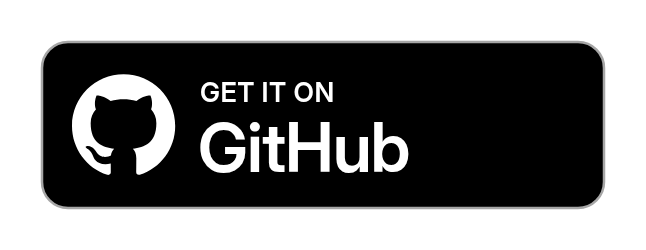</a>
  <a href="https://hermes.xpetalab.dev/obtainium/"></a>
  <a href="https://hermes.xpetalab.dev">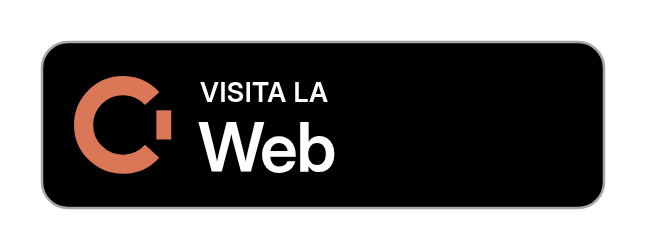</a>
  <br><br>
  <a href="README.md">English</a> · Español
</p>

<p align="center">
  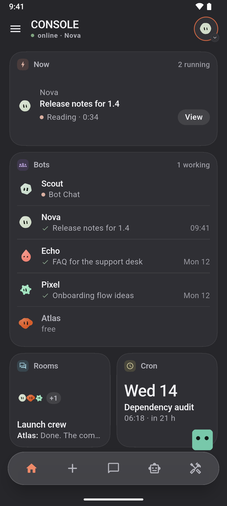
  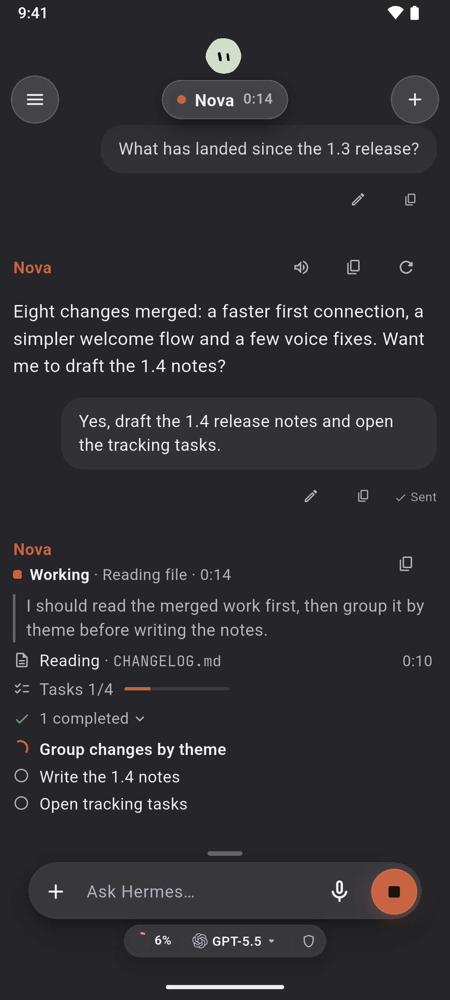
  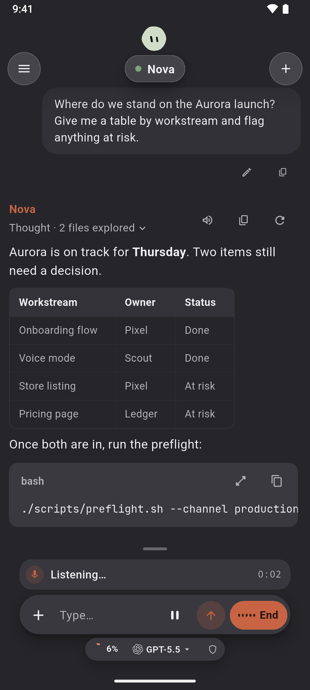
  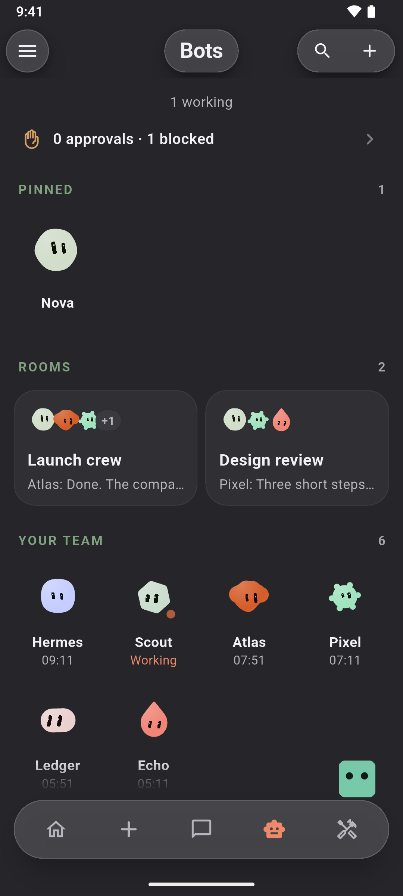
</p>

## Qué es

Console es una app independiente de Android para [Hermes Agent](https://github.com/NousResearch/hermes-agent), el agente que ejecutas en tu propio ordenador o servidor. Habla directamente con el Gateway y el Dashboard del propio Hermes, sin cuenta de Console ni un servidor nuestro por medio.

## Conecta

Ejecútalo donde vive Hermes y escanea el código que muestra. Requiere Console 1.2.15 o posterior.

```sh
# Linux, macOS
curl -fsSL https://raw.githubusercontent.com/xP3ta/hermes-setup/main/hermes-mobile-setup.sh | sh
```

```powershell
# Windows, WSL2 (Windows PowerShell 5.1+, como administrador)
irm https://raw.githubusercontent.com/xP3ta/hermes-setup/main/hermes-mobile-setup.ps1 | iex
```

<details>
<summary>¿Vienes de una instalación anterior?</summary>

<br>

Console 1.2.15 ya no usa el Mobile Bridge. Cuando todos tus móviles tengan la 1.2.15 o posterior, una línea quita el bridge del ordenador y nada más:

```sh
curl -fsSL https://raw.githubusercontent.com/xP3ta/hermes-setup/main/hermes-mobile-setup.sh | sh -s -- --retire-bridge
```

```powershell
& ([scriptblock]::Create((irm https://raw.githubusercontent.com/xP3ta/hermes-setup/main/hermes-mobile-setup.ps1))) -RetireBridge
```

</details>

## Qué puedes hacer

- Un chat que muestra el trabajo: razonamiento, herramientas y tareas, con palabras normales
- Conversaciones de voz dentro del chat
- Bots y salas, una identidad por perfil de Hermes
- Tareas programadas (Cron) y tareas, en tablero o en lista
- Modelos, con eliminación real de proveedores
- Terminal SSH, SFTP y visores de archivos integrados

<details>
<summary>Más pantallas</summary>

<br>

<p align="center">
  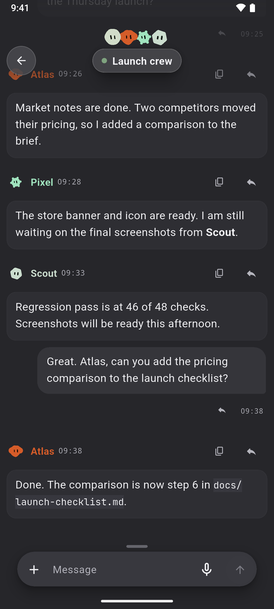
  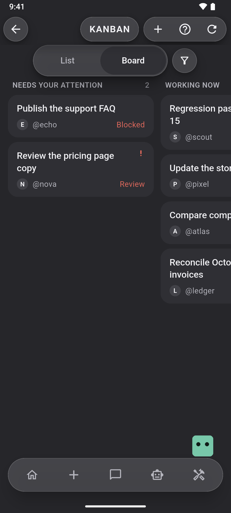
  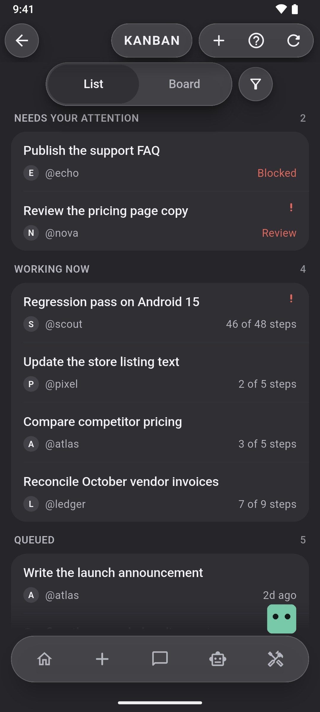
  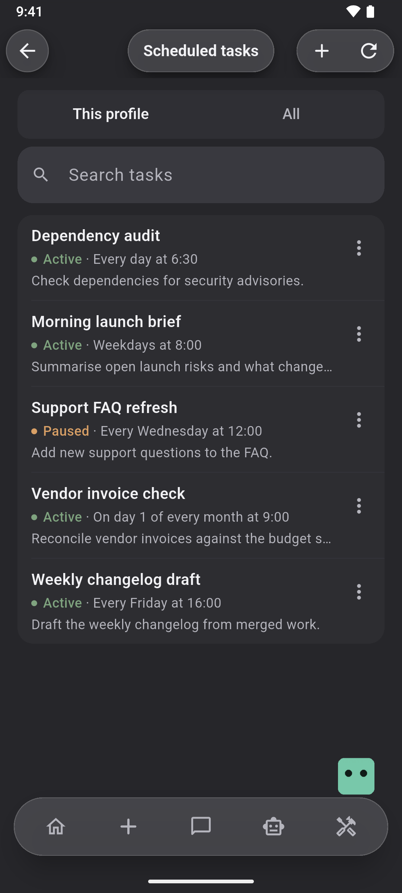
  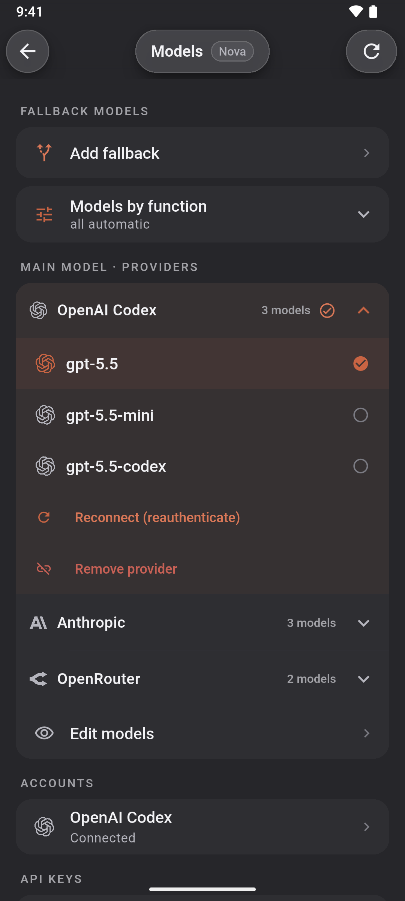
  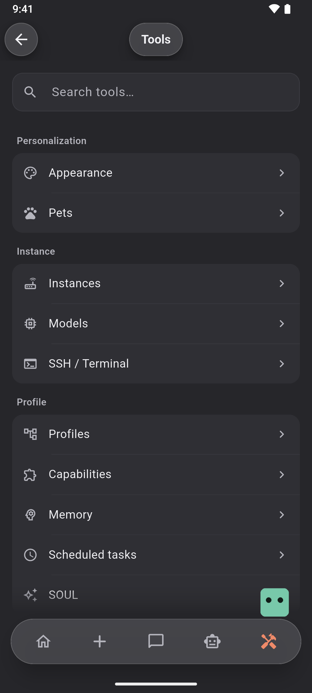
  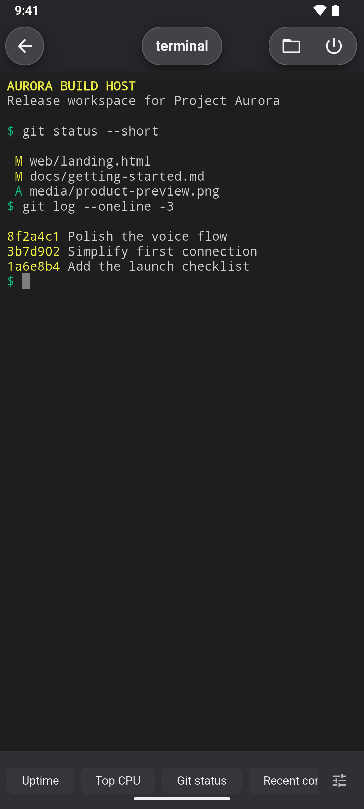
  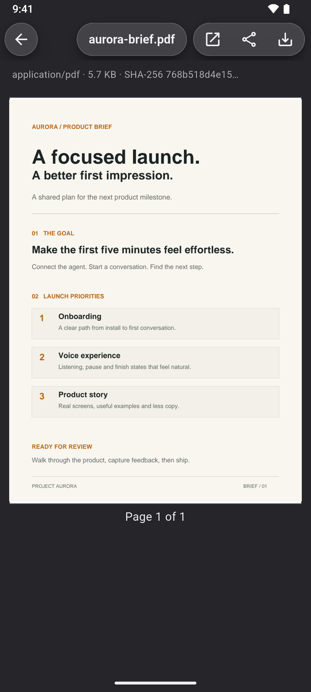
  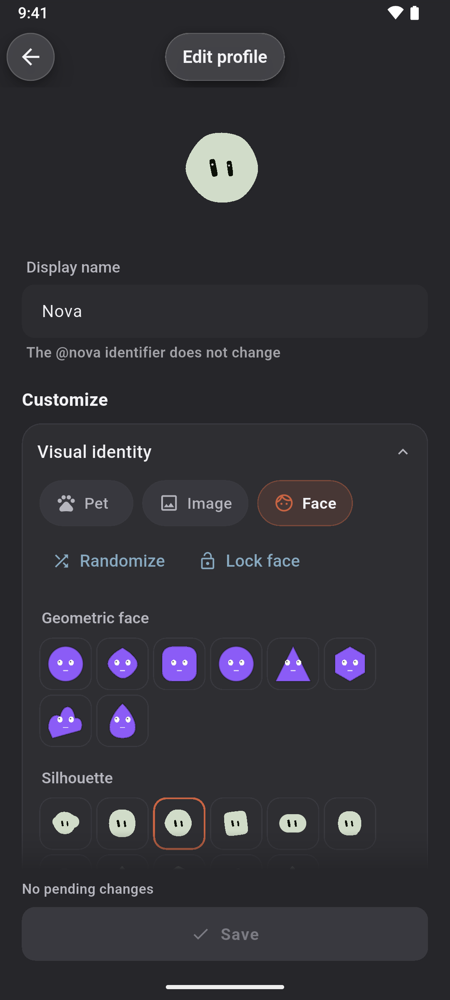
  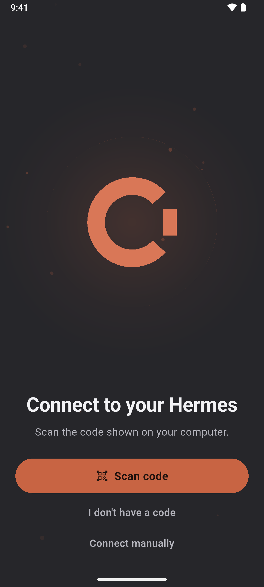
  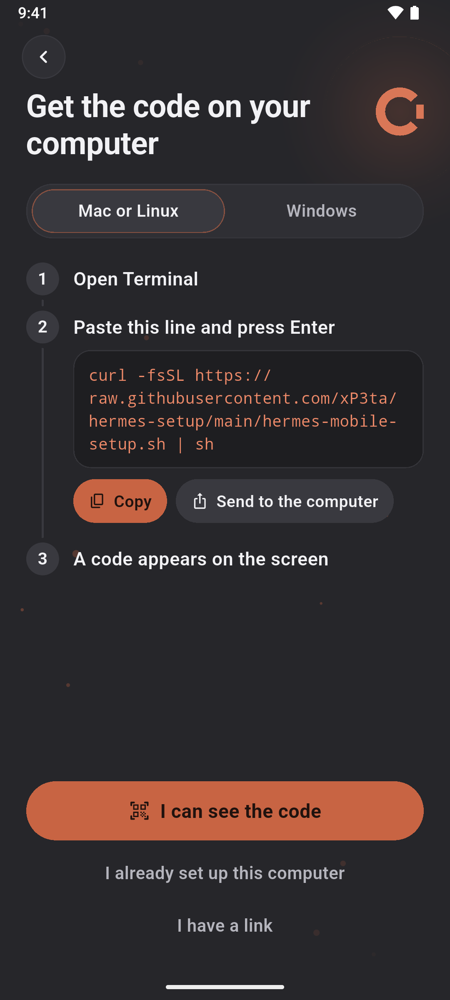
  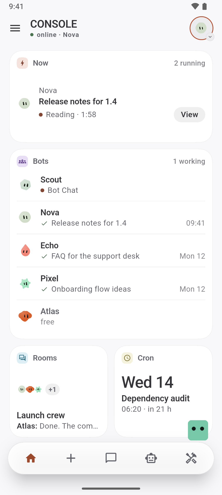
  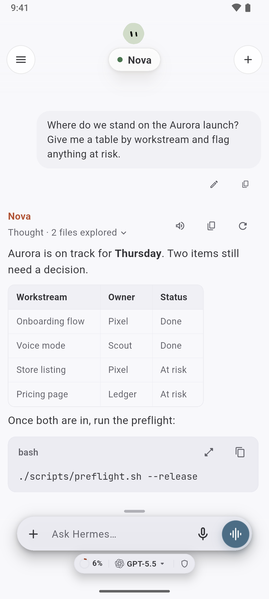
</p>

</details>

## Privada por diseño

- Autoalojada: sin cuenta, sin telemetría, sin publicidad
- Las credenciales se quedan en el móvil, en el Keystore de Android
- HTTP sin cifrar solo en redes privadas; HTTPS en cualquier otro caso

## Apoya el proyecto

Console es gratuita y la hago en mi tiempo libre. Si te resulta útil, un café ayuda a que siga adelante.

<p align="center">
  <a href="https://ko-fi.com/xpeta"></a>
</p>

<p align="center">
  <a href="docs/README.md">Documentación</a> · <a href="CHANGELOG.md">Cambios</a> · <a href="SECURITY.md">Seguridad</a> · <a href="CONTRIBUTING.md">Contribuir</a> · <a href="https://ko-fi.com/xpeta">Apoyar</a> · <a href="LICENSE">GPL-3.0</a>
  <br>
  <sub>Proyecto independiente de XPeta Lab, sin relación con Nous Research.<br>Google Play y el logotipo de Google Play son marcas comerciales de Google LLC.</sub>
</p>
